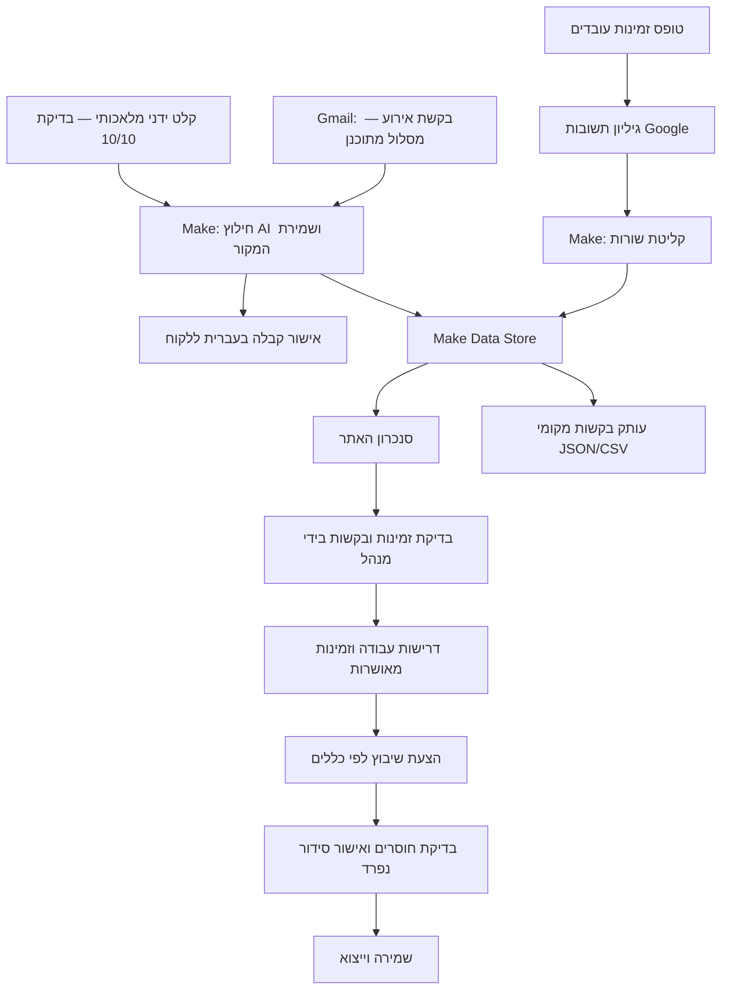

# אמירו גרין - מסמך פרויקט

**מגיש: מוחמד בדארנה**  
קורס הטמעת כלי AI בארגונים | נכתב: 08/10/2026 | עודכן: 10/10/2026 | הצגה מתוכננת: 14/10/2026

**מצב המסמך:** נוסח מעודכן לקראת ההגשה. האפיון נוסח מתוך דרישות הפרויקט הקיים; לא נטען שנערך ראיון או שהיה PRD קודם. נתוני העלות, נפח העבודה וזמני הטיפול הם הנחות תכנון. ב-10/10/2026 הושלמה הרצת Make אמיתית: טקסט בקשה מלאכותי הוזן ידנית, חולץ ב-Make AI Provider ונשמר במאגר בדיקה נפרד. קליטת התוצאה באתר, בדיקת מנהל, הצעת שיבוץ והקלטה עדיין ממתינות לאימות. מסלולי Gmail ו-Google Forms לא הורצו מהתחלה ועד הסוף, וההפעלה המסחרית נשארת מושהית.

## 1. האפיון (PRD)

### הבעיה והמשתמש

ניסוח הצורך בשפת מנהל התפעול: "כדי להכין סידור עבודה לשבוע הקרוב, אני צריך לאסוף מתי כל עובד פנוי, להבין מה הלקוח מבקש, לבדוק מי מתאים לכל משמרת ולוודא שלא חסרים עובדים או שיש חפיפות. כשפרט משתנה, אני צריך לבדוק מחדש שהכול עדיין מתאים לפני שאני מאשר."

המשתמש העיקרי הוא מנהל התפעול בחברת אבטחה. העובדים מוסרים זמינות, והלקוחות שולחים בקשות לאבטחת אירועים. הבעיה היא הזמן והבדיקות הדרושים כדי להפוך את המידע לסידור שניתן לאשר. זהו הצורך שהוגדר לפרויקט, ולא ממצא ממחקר עסקי.

### חמש פעמים "למה"

1. למה הכנת הסידור דורשת זמן? צריך להשוות דרישות עבודה לזמינות ולהכשרות העובדים.
2. למה ההשוואה דורשת עבודה ידנית? המידע מגיע בערוצים ובמבנים שונים, כגון דואר וטפסים.
3. למה מידע חסר מקשה על התכנון? תאריך, שעות, מספר עובדים והכשרה צריכים להתאים יחד.
4. למה חוזרים על הבדיקות? שינוי בבקשה או בזמינות משנה התאמה שכבר נבדקה.
5. למה קשה לדעת מה כבר מותר לבצע? צריך להבחין בין מידע שהתקבל, מידע שנבדק וסידור שאושר.

שורש הבעיה שהוגדר: חסר רצף עקבי שמקשר בין פרטי המקור, בדיקת התאמה והחלטת המנהל.

### מטרות וגבולות הגרסה הראשונה

להדגים קליטת זמינות ובקשת אירוע, בדיקת פרטים, יצירת הצעת שיבוץ ואישור מנהל. דרישות הליבה: טופס קצר עם שבוע אוטומטי; שמירת מקור הבקשה; בדיקה לפני שינוי מידע מאושר; שיבוץ לפי זמינות, הכשרה, מנוחה, חפיפות ומכסת שעות; הצגת חוסרים ואישור סידור נפרד.

**מדד הצלחה מוצע:** הכנת טיוטת סידור שבועי ובדיקתה מ-90 דקות ל-45 דקות באותו תרחיש בדיקה, לאחר קליטת הזמינות והבקשות. שני המספרים הם הנחת בסיס ויעד, ולא תוצאה שנמדדה. בפיילוט יימדדו שתי השיטות עם אותם עובדים ודרישות. יעדי איכות: אפס כפילויות, אפס הפרות כללי שיבוץ במקרי הבדיקה ו-100% בדיקת מנהל לפני אישור.

מחוץ לגרסה הראשונה: הפעלה מסחרית, שימוש בנתוני לקוחות אמיתיים, החלטות עצמאיות על העסקת עובדים, שליחה אוטומטית של סידור מאושר, שכר או חשבוניות מחייבים, שירות ציבורי עם הרשאות חברה וסנכרון עריכות Excel חזרה לאתר. אין הבטחה לשיבוץ מיטבי.

## 2. הפתרון והארכיטקטורה

נבנה אתר בעברית המרכז עובדים, זמינות, בקשות, דרישות עבודה, סידור, שעות וסיכומי כספים. האתר המקומי כולל נתוני הדגמה. Google Forms ו-Sheets משמשים לאיסוף מובנה של זמינות; Make מעביר רשומות למאגר ומחלץ פרטים מטקסט של בקשת דואר; האתר קורא את המאגר ומציג מידע לבדיקה.

נבחר שילוב של אוטומציה וחילוץ AI מוגבל: טקסט של לקוח עשוי להיות לא מובנה, ואילו התאמת עובד למשמרת דורשת כללים מפורשים ובדיקה אנושית. אין במימוש צוות סוכנים או RAG. חילוץ הדואר ב-Make ועוזר AI אופציונלי באתר הם רכיבים נפרדים. **מנוע השיבוץ מבוסס על כללים, ולא על מודל AI.**

כלים: ממשק TypeScript/React, ממשקי שרת מקומיים, אחסון היישום, Google Forms/Sheets/Gmail, Make ומאגר הנתונים שלו. קוד כללי השיבוץ נמצא ב-`source/lib/domain.ts`; הסנכרון והבדיקות נכללים בחבילת הקוד. בחיבור המקומי האתר קורא את Make דרך API; אין צורך ב-webhook ציבורי למחשב. מפתחות מוגדרים בשרת ואינם חלק מהקוד שנמסר.

עדכון תאריכי השבוע בשני הטפסים נעשה כיום באמצעות אוטומציית Codex ובהתאם לתאריך המחשב באזור ירושלים. זו תלות בסביבת הסטודנט שצריך להחליף או להגדיר בהעברה לחברה. חלופת Apps Script הוכנה בחבילה, אך לא הותקנה או הופעלה. השבוע של תשובה נשמר לפי חותמת הזמן שלה, כדי שלא להזיז תשובות ישנות לשבוע חדש.

הדיאגרמה מציגה את הארכיטקטורה הכוללת. בדיקת ה-10/10 התחילה בקלט ידני מלאכותי ב-Make, והשתמשה במאגר בדיקה נפרד; היא לא הפעילה קבלת Gmail, שליחת Google Form או תגובה בדואר. המסלול באתר והחלטת המנהל עדיין ממתינים לאימות. מקור בקשה עלול להישמר ב-Make לפני השלמת חילוץ ה-AI; תיקון הקליטה ממתין לבדיקת סנכרון באתר כדי לוודא שיובא הפלט המלא. אישור קבלה אינו אישור עבודה. המנהל צריך לבדוק גם חוסרים לפני אישור הסידור; כפתור האישור לבדו אינו מבטיח שהכול אויש.

### תוצאת הבדיקה הטכנית — 10/10/2026

| נתון שנצפה | תוצאה |
|---|---|
| מסלול הבדיקה | קלט טקסט מלאכותי ידני → Make AI Provider → JSON → Make Data Store לבדיקה |
| תרחיש והרצה | תרחיש 7875039; הרצה `b32572cec6654ca6a3885037b723d5db` |
| מצב | הצלחה בחמשת מודולי התרחיש; 3 פעולות דווחו ברישום ההרצה |
| משך Make | 6,472 מילישניות, כלומר 6.472 שניות |
| צריכת הקרדיט שדווחה | 5.89 קרדיטים להרצה זו |
| טקסט הניסוי | חברת אירועי הדגמה; אולם הדגמה; מאבטח אחד; 10/10/2026, 12:00–16:00; 80 ₪ לשעה |
| תוצאה שנשמרה | פרטי בקשה מובנים במאגר בדיקה 213123, במצב `draft_unvalidated` |
| פרטים שחייבים בדיקה | השם והטלפון שחולצו כוללים נקודה בסופם; פלט מודל הוא טיוטה לבדיקה |
| מה עדיין לא הוכח | Gmail/Forms, תגובה בדואר, קליטה באתר, החלטת מנהל ושיבוץ |

זמן ההרצה וצריכת הקרדיט הם תצפית טכנית בניסוי אחד. הם אינם זמן טיפול עסקי, עלות חודשית מאומתת או מדידת חיסכון. בבדיקה לפני הניסוי אושר חשבון Make בתוכנית Core עם הקצאה של 10,000 קרדיטים; אין בטבלה טענה ליתרה לאחר הניסוי.

## 3. אבטחה ורגולציה

### שלושה סיכונים והגנות

| סיכון | הגנה במימוש או בתוכנית הבדיקה |
|---|---|
| חשיפת פרטי לקוח, עובד או מפתח גישה | בהדגמה משתמשים במידע מלאכותי; תבניות המפתחות ריקות וקובצי סביבה מוחרגים מ-Git. לפני שימוש עסקי נדרשים חשבונות חברה, הרשאות מצומצמות, בקרת גישה ובדיקת מדיניות שמירה; אלה אינם מוצגים כפריסת ייצור קיימת |
| חילוץ שגוי או הוראות מטעות בתוך הודעת לקוח | מקור הבקשה מוצג לצד הטיוטה. המנהל בודק ומתקן פרטים; אין אישור עבודה אוטומטי. בפיילוט ייבדקו פרטים חסרים וטקסט מטעה, כדי לוודא שאינו הופך להחלטת עבודה |
| שיבוץ לא מתאים או לא הוגן | המנוע בודק כללי זמינות, הכשרה, מנוחה וחפיפה. המנהל בודק חוסרים ומאשר בנפרד. סדר העדיפות כולל שעות שכבר שובצו ולאחריהן שכר; לכן נדרש לבדוק חלוקת עבודה ולא לטעון להוגנות מוכחת |

### תנועת מידע ואישור אדם

השם, הטלפון והזמינות נשלחים ל-Google Forms/Sheets ומשם ל-Make. תוכן בקשת הדואר והשדות שחולצו נשמרים ב-Gmail וב-Make; חילוץ AI מעביר טקסט לשירות המודל שנבחר בחיבור. לפיכך **המידע אינו נשאר רק במחשב**. מצב היישום והעותק המקומי של הבקשות נשמרים במחשב בהפעלה המקומית; אם האתר יפורסם, יש לבחון מחדש את מקום האחסון.

המנהל מאשר זמינות ופרטי בקשה לפני יצירת עבודה, ומאשר בנפרד את הסידור. התגובה האוטומטית המתוכננת בדואר מודיעה רק שהבקשה התקבלה לבדיקה. עותק JSON/CSV אינו משקף אוטומטית החלטות מנהל מהאתר, ושינוי בו אינו מעדכן את האתר.

### רמת סיכון לפי EU AI Act

**הערכת הסיווג לפרויקט:** רכיב ה-AI המוגבל לחילוץ טקסט של בקשת לקוח, ללא דירוג או פרופיילינג עובדים, מוערך לצורך האפיון כבעל סיכון נמוך. זו הערכת היקף מנומקת, ולא אישור עמידה משפטית. מנוע השיבוץ הנוכחי משתמש בכללים שנכתבו בקוד; אין להציגו כמערכת AI המקבלת החלטות העסקה.

הרחבת AI להקצאת עבודה לפי מאפיינים אישיים או להערכת עובדים עשויה להיכלל בקטגוריית סיכון גבוה של ניהול עובדים, לפי נספח III סעיף 4. [מקור רשמי: הנציבות האירופית, Annex III](https://ai-act-service-desk.ec.europa.eu/en/ai-act/annex-3).

אישור אדם אינו פוטר אוטומטית מסיווג גבוה. סעיף 6(3) מאפשר חריגים בתנאים מוגדרים למשימות צרות או מכינות, ומחייב לבחון השפעה על החלטות וסיכוני זכויות; פרופיילינג במסגרת נספח III נותר בסיכון גבוה. לפני הרחבה עסקית נדרשים תיעוד הערכה ובדיקת תחולת הדין על ההפעלה המיועדת. [מקור רשמי: Article 6](https://ai-act-service-desk.ec.europa.eu/en/ai-act/article-6). המקורות נבדקו ב-08/10/2026.

## 4. תוכנית עסקית ו-ROI

**כל המספרים בפרק הם הנחות תכנון להמחשה בלבד.** לא התקבלו נתוני זמן או עלות מהחברה ולא אומתו מחירי ספקים. הזמנים כוללים בדיקה אנושית ומתייחסים לשלבים נפרדים כדי למנוע כפל ספירה. הנחת ערך שעה: 60 ₪.

| פעילות | נפח חודשי משוער | זמן לפני | יעד זמן אחרי | חיסכון חודשי בדקות |
|---|---|---|---|---|
| קליטת ובדיקת זמינות | 20 עובדים × 4 מחזורים = 80 דיווחים | 10 דקות | 3 דקות | 80 × (10 - 3) = 560 |
| טיפול בבקשות אירוע | 20 בקשות | 15 דקות | 5 דקות | 20 × (15 - 5) = 200 |
| הכנת טיוטת סידור ובדיקתה אחרי קליטת המידע | 4 מחזורים | 90 דקות | 45 דקות | 4 × (90 - 45) = 180 |
| סך הכול | | | | 940 |

940 / 60 = 15.67 שעות פנויות בחודש, בעיגול לשתי ספרות. הערך ברוטו מחושב מהמספר לפני עיגול: (940 / 60) × 60 = **940 ₪ לחודש**. זהו ערך זמן שהתפנה לעבודה אחרת; אין בכך הוכחה לירידה בתשלומי השכר.

| עלות הקמה והדרכה | חישוב משוער | תקציב |
|---|---|---|
| פיתוח והתאמה | 16 שעות × 60 ₪ | 960 ₪ |
| הגדרת חיבורים ובדיקות | 8 שעות × 60 ₪ | 480 ₪ |
| הדרכת 5 עובדים ומנהל | (5 × 0.5 שעה + 1.5 שעה) × 60 ₪ | 240 ₪ |
| סך הכול חד-פעמי | 960 + 480 + 240 | 1,680 ₪ |

| עלות חודשית | הנחת תקציב | סכום |
|---|---|---|
| Make וכלים | תקציב תכנון ללא המודל בשורה הבאה | 80 ₪ |
| מודל או קרדיטי AI | עתודה ללא מחיר ספק מאומת | 60 ₪ |
| אירוח וגיבוי | תקציב תכנון | 30 ₪ |
| תחזוקה ותמיכה | 2 שעות × 60 ₪ | 120 ₪ |
| סך הכול | 80 + 60 + 30 + 120 | 290 ₪ |

התקציב מניח מחשב וחיבור אינטרנט קיימים: רכישה נוספת של שניהם 0 ₪. אם AI כבר כלול בתקציב Make, מחלקים את התקציב בין השורות בלי לספור פעמיים. תקציב ההקמה הוא תרחיש לתכנון, ואינו דיווח על שעות הפיתוח שהושקעו בפרויקט. המספרים אינם הצעת מחיר, אינם כוללים שיטת מיסוי ואינם מציגים חיסכון תעסוקתי מובטח.

| תוצאה בתרחיש ההנחות | חישוב |
|---|---|
| ערך חודשי נטו | 940 - 290 = **650 ₪** |
| זמן החזר | 1,680 / 650 = **2.58 חודשים** |
| ערך נטו בשנה הראשונה | 12 × 650 - 1,680 = **6,120 ₪** |
| עלות מלאה בשנה הראשונה | 1,680 + 12 × 290 = **5,160 ₪** |
| ROI מול העלות המלאה בשנה הראשונה | (6,120 / 5,160) × 100 = **118.6%** |
| ROI ביחס להשקעת ההקמה בלבד בשנה הראשונה | (6,120 / 1,680) × 100 = **364.3%**; זהו בסיס השוואה שונה |
| מימוש רק 50% מהחיסכון | 470 - 290 = 180 ₪ לחודש; 1,680 / 180 = 9.33 חודשי החזר |
| מימוש רק 25% | 235 - 290 = **הפסד של 55 ₪ לחודש** |
| נקודת איזון של העלות החודשית | 290 / 60 = 4.83 שעות חיסכון בחודש |

הבחירה העסקית תיעשה לאחר מדידה בפיילוט והחלפת ההנחות במחירים ובנתוני החברה. בפיילוט של חמישה עובדים אין בסיס להציג את ההערכה של עשרים עובדים כתוצאה שנמדדה.

## 5. תוכנית הטמעה

מוצע פיילוט עתידי של שבועיים עם מנהל אחד, חמישה עובדים ומתפעל טכני, בחשבונות בדיקה ובמידע מלאכותי. בשבוע הראשון מודדים טיפול ידני באותם נתונים, מתרגלים זמינות ומכינים עשר בקשות אירוע. בשבוע השני מריצים שני מחזורי שיבוץ, מודדים את הטיפול במערכת ורושמים תיקונים ותקלות. הפיילוט עדיין לא בוצע.

| מדד | יעד מתוכנן |
|---|---|
| זמינות | 5 מתוך 5 דיווחים חדשים משויכים לעובד ולשבוע הנכונים |
| חילוץ דואר | לפחות 9 מתוך 10 בקשות משקפות את כל השדות שנמסרו, בלי להמציא פרטים חסרים |
| כפילויות | 0 כפילויות לאחר סנכרון חוזר |
| כללי שיבוץ | 0 הפרות זמינות, הכשרה, מנוחה וחפיפה במקרי הבדיקה |
| אישור אנושי | 100% בדיקת מנהל לפני אישור בקשות וסידורים |
| זמן הכנת סידור | יעד 90 ל-45 דקות; עדכון לפי המדידה בפועל |
| מסירה מלאה | מזהה הרצת Make ותוצאה תואמת באתר |

עוצרים אם נשלחת הודעה מחוץ לנמעני הבדיקה, מופיע מידע אישי אמיתי, מתפרסם סידור ללא אישור או מתגלה הפרת כלל שיבוץ. בחיבור לא זמין חוזרים לטיפול ידני, מתעדים ומחדשים את הבדיקה אחרי תיקון. המדגם בודק היתכנות בלבד, ולא מוכיח דיוק כללי.

בעל החברה עשוי לחשוש מהעלות: מציגים תקציב מוגבל ומדידות. המנהל עשוי לחשוש מאובדן שליטה: נשמרת סמכות תיקון ואישור. העובדים עשויים לחשוש ממעקב ומקושי: מסבירים את המידע שנאסף ומתרגלים את הטופס. המתפעל אחראי להגדרות, לחיבורים ולשחזור. ההדרכה המוצעת: חצי שעה לכל עובד, ושעה וחצי למנהל לבדיקת מקור, תיקון פרטים, חוסרים ואישורים.

## 6. הצעדים הבאים והלמידה

ב-10/10/2026 נפתרה מגבלת החשבון: אושרה תוכנית Make Core והורצה בהצלחה בקשה מלאכותית דרך AI ומאגר בדיקה. לקראת ההצגה משלימים את קליטת התוצאה באתר, בדיקת המנהל, הצעת שיבוץ ואישור, ושומרים הקלטת מסך אמיתית של עד שתי דקות. צילום של תרחיש שמור אינו מחליף הוכחת הרצה. יש לבדוק את תזמון החילוץ והסנכרון ולהוסיף רק תוצאות שנצפו בפועל. אין כאן הפעלה של דואר או משמרות עסקיים.

לאחר פיילוט מוצלח: מקבלים את אישור בעל החברה, מגדירים חשבונות חברה, משלימים אבטחת מידע ועלויות אמת, ואז מרחיבים לקבוצה נוספת ולכל הצוות. הפצה ציבורית, בקרת גישה, גיבוי ושחזור ותמיכה הן עבודות נפרדות מההדגמה המקומית.

הלקח מהבנייה: חילוץ AI הוא רק חלק מהתהליך. נדרשים מקור שניתן לבדוק, זיהוי שבוע ועובד, קליטה עקבית, כללי שיבוץ ומנהל שמאשר. הכללים ניתנים לבדיקה מפורשת; החיבור החיצוני דורש הרצה אמיתית כדי להוכיח מסירה. ההבחנה בין תכנון, בדיקה מדומה והרצה מלאה מאפשרת להציג את יכולות המערכת בצורה מדויקת.

**שימוש ב-AI:** נעזרתי ב-Codex לארגון דרישות הפרויקט, הכנת קוד ותיעוד, עזרה בבדיקות וטיוטות הדוח והמצגת. Make AI Provider ביצע בפועל חילוץ פרטי בקשת הדגמה בניסוי ה-10/10. מנוע השיבוץ מבוסס על כללים. ההנחות העסקיות מסומנות לבדיקת הסטודנט.

**מקורות ותוצרי אימות:** הוראות הקורס שסופקו; README בחבילת הקוד; `source/lib/domain.ts`; תיקיות `validation/` ו-`evidence/`. תוצאת Make החיה מתועדת בהרצה הנזכרת בפרק 2. קליטת האתר, בדיקת המנהל והקלטת החובה עדיין ממתינות לאימות. טרם פורסם מאגר GitHub וטרם הוגש דבר במודל.
